# LeadPilot P0 技术实现方案（详细设计）v0.1

日期：2026-11-17 ｜ 约束：单人零起步 / Python / 托管PG / <400元月
上游：product-design-v0.1.md、tech-architecture-v0.1.md(§10/§11)、industry-and-p0-plan-v0.1.md(§14 runbook)
本文档为骨架代码的唯一依据：架构图/时序图/ER图/表设计/接口设计/稳定性设计/测试与发布。

---

## 1. 架构图

### 1.1 组件与部署（mermaid）
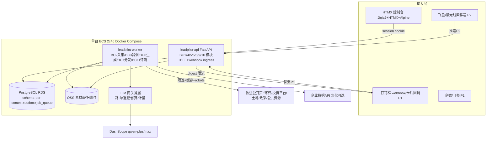

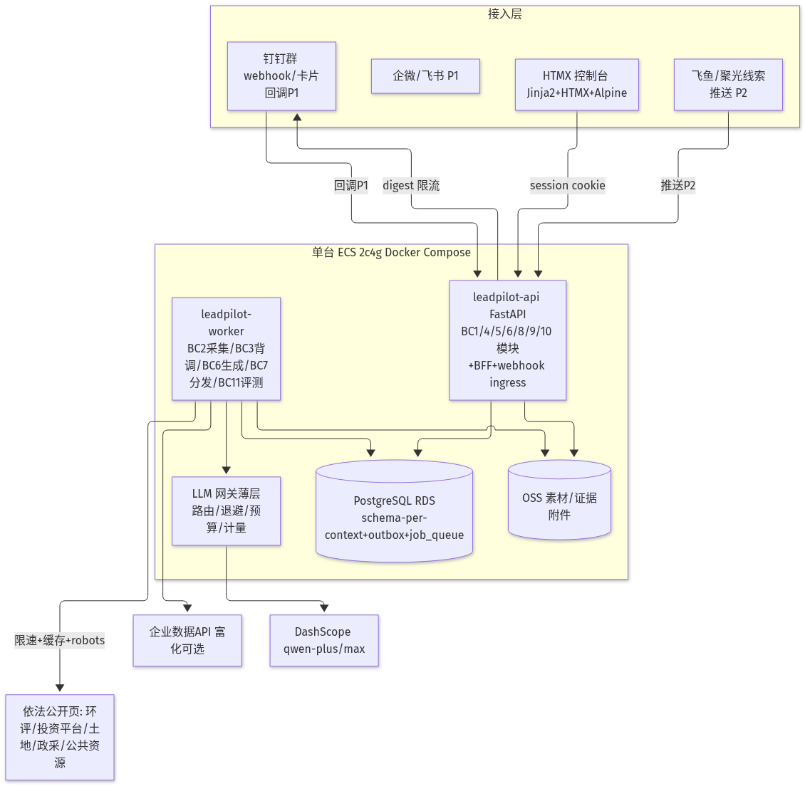

要点：两进程一库；worker 独占外部采集/LLM/分发出口（故障域隔离）；api 只做 BFF/验收/门禁/看板/webhook ingress；outbox 由 worker 内 dispatcher 消费（P0 进程内，P1 独立）。

### 1.2 模块依赖规则（import-linter 契约）
- contexts 之间禁止直接 import models/service；只允许经 shared.events 事件信封 + 显式 DTO（published language）。
- 例外（同步 OHS）：content→evidence.validate_claim；任何context→compliance.gate_check；任何context→tenant.config_snapshot。
- shared 不 import contexts。api/worker 只 import contexts 的 service 门面与 shared。

---

## 2. 时序图

### 2.1 Outbound 线索主链路（crawl→验收→计费）
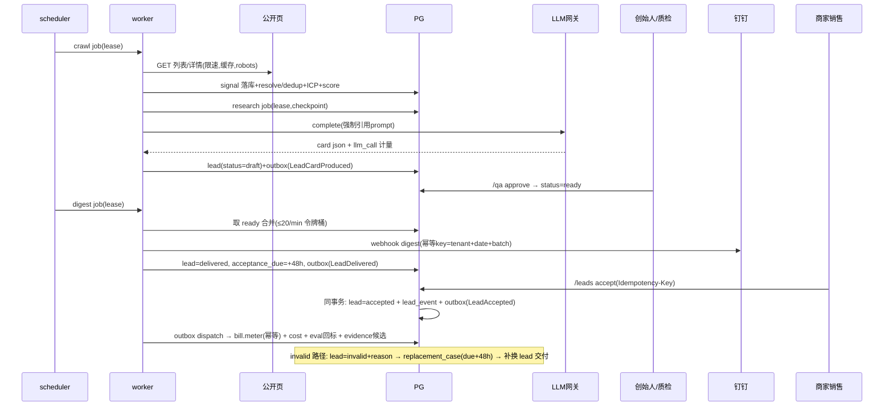

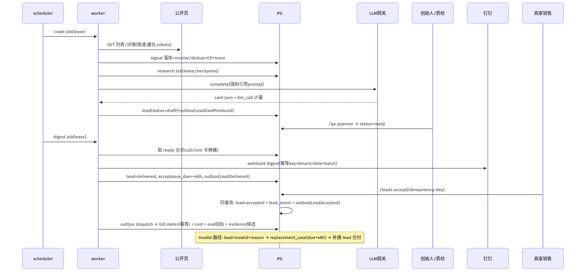


### 2.2 Inbound 内容发布（门禁链）
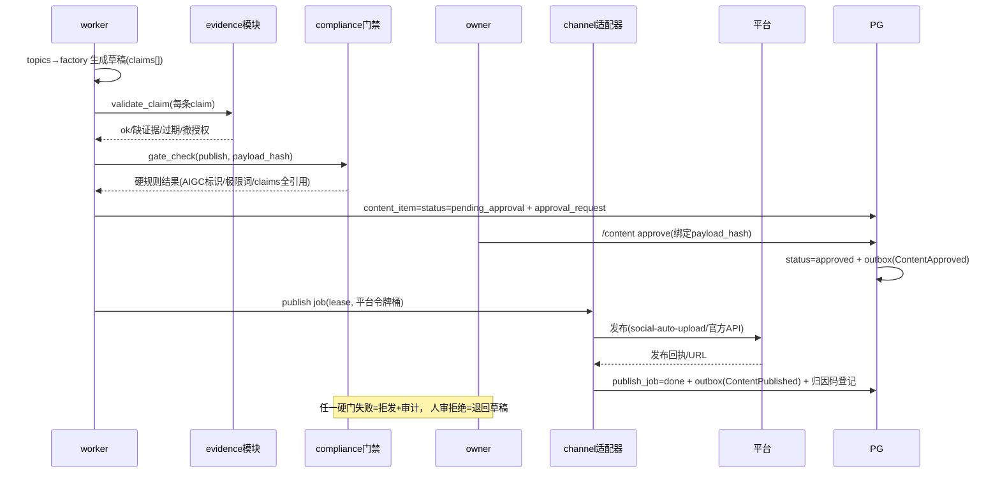

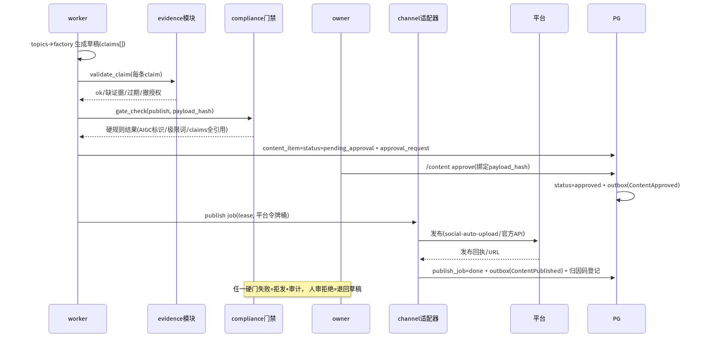


### 2.3 证据撤销传播
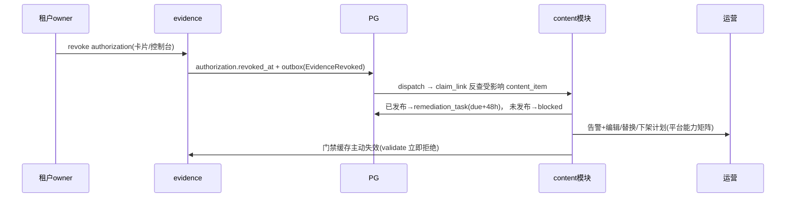

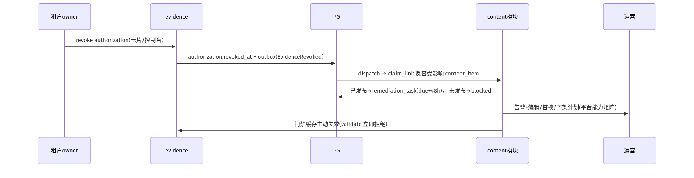


### 2.4 租约续跑（chaos 语义）
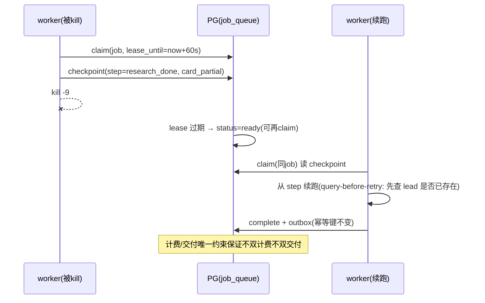

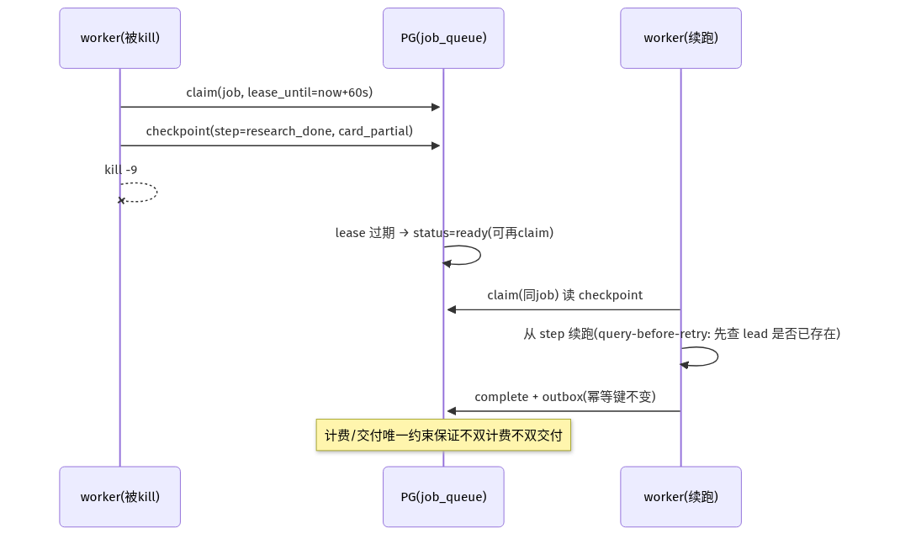


---

## 3. ER 图
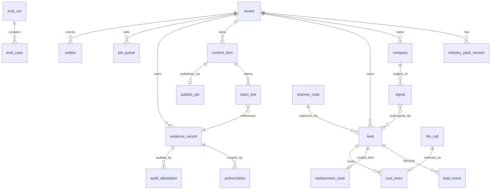

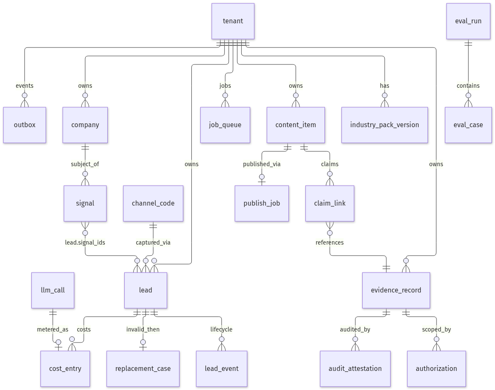


---

## 4. 数据库表设计（PostgreSQL 16，schema-per-context）

约定：uuid PK=gen_random_uuid()；时间=timestamptz default now()；金额=numeric(12,2)；
全业务表含 tenant_id（P0 应用层过滤，P1 开 RLS）；jsonb 存证据/卡片/配置；软删除不用，状态机表达。
扩展：pgcrypto 内置不需要；pgvector 可选（目录 embedding，缺省时降级 tsvector+规则）。

```sql
CREATE SCHEMA IF NOT EXISTS tn;   -- 租户与配置
CREATE SCHEMA IF NOT EXISTS sig;  -- 信号与企业
CREATE SCHEMA IF NOT EXISTS ld;   -- 线索生命周期
CREATE SCHEMA IF NOT EXISTS bill; -- 计费与成本
CREATE SCHEMA IF NOT EXISTS ct;   -- 内容与渠道
CREATE SCHEMA IF NOT EXISTS ev;   -- 证据
CREATE SCHEMA IF NOT EXISTS comp; -- 合规审计
CREATE SCHEMA IF NOT EXISTS evl;  -- 评测
CREATE SCHEMA IF NOT EXISTS ops;  -- 队列/outbox/观测

-- ========== tn ==========
CREATE TABLE tn.tenant (
  id uuid PRIMARY KEY DEFAULT gen_random_uuid(),
  name text NOT NULL, slug text UNIQUE NOT NULL,
  mode text NOT NULL DEFAULT 'managed',           -- managed|self_serve
  office_stack text[] NOT NULL DEFAULT '{dingtalk}',
  status text NOT NULL DEFAULT 'active',
  created_at timestamptz NOT NULL DEFAULT now()
);
CREATE TABLE tn.industry_pack_version (
  id uuid PRIMARY KEY DEFAULT gen_random_uuid(),
  tenant_id uuid NOT NULL REFERENCES tn.tenant(id),
  pack_key text NOT NULL, version int NOT NULL,
  spec jsonb NOT NULL,                            -- region/categories/signals/rubric/qualified/billing/content
  rollout text NOT NULL DEFAULT 'shadow',         -- shadow|canary|full|retired
  eval_run_id uuid,                               -- 过门禁证明
  created_at timestamptz NOT NULL DEFAULT now(),
  UNIQUE (tenant_id, pack_key, version)
);
CREATE TABLE tn.catalog_item (                    -- 商家目录(匹配用)
  id uuid PRIMARY KEY DEFAULT gen_random_uuid(),
  tenant_id uuid NOT NULL REFERENCES tn.tenant(id),
  category text NOT NULL, keywords text[] NOT NULL DEFAULT '{}',
  specs jsonb NOT NULL DEFAULT '{}', budget_floor numeric(12,2),
  embedding vector(1024),                         -- pgvector 可选
  active boolean NOT NULL DEFAULT true
);

-- ========== sig ==========
CREATE TABLE sig.company (
  id uuid PRIMARY KEY DEFAULT gen_random_uuid(),
  tenant_id uuid NOT NULL REFERENCES tn.tenant(id),
  name text NOT NULL, credit_code text,
  region text, industry text, reg_status text,
  enriched_at timestamptz,
  UNIQUE (tenant_id, name, coalesce(credit_code,''))
);
CREATE TABLE sig.signal (
  id uuid PRIMARY KEY DEFAULT gen_random_uuid(),
  tenant_id uuid NOT NULL REFERENCES tn.tenant(id),
  source text NOT NULL,                           -- js_eia|tzxm|land_market|ccgp|ggzy|award|company_api|news
  stage text NOT NULL,                            -- pre_bid|bid|post_bid
  project_name text NOT NULL, company_id uuid REFERENCES sig.company(id),
  budget numeric(14,2), deadline date,
  public_contact jsonb NOT NULL DEFAULT '{}',     -- {name,role,phone,email} 仅依法公开经营性联系
  evidence_urls jsonb NOT NULL DEFAULT '[]',
  raw_text text, raw_hash text NOT NULL,
  observed_at timestamptz NOT NULL, ttl_at timestamptz NOT NULL,
  status text NOT NULL DEFAULT 'new',             -- new|matched|dropped|expired
  dedup_key text NOT NULL,                        -- company+project+source
  created_at timestamptz NOT NULL DEFAULT now(),
  UNIQUE (tenant_id, dedup_key)
);
CREATE INDEX idx_signal_ttl ON sig.signal (tenant_id, ttl_at) WHERE status='new';
CREATE INDEX idx_signal_stage ON sig.signal (tenant_id, stage, observed_at DESC);

-- ========== ld ==========
CREATE TABLE ld.lead (
  id uuid PRIMARY KEY DEFAULT gen_random_uuid(),
  tenant_id uuid NOT NULL REFERENCES tn.tenant(id),
  company_id uuid NOT NULL REFERENCES sig.company(id),
  signal_ids jsonb NOT NULL DEFAULT '[]',
  source_type text NOT NULL,                      -- outbound_signal|inbound_content|engagement_*|ad_lead|channel_qr|landing
  intent_tier smallint NOT NULL DEFAULT 3,
  stage text, score numeric(4,3), confidence text,
  card jsonb NOT NULL,                            -- 线索卡(含证据/话术/窗口/incumbent_hint)
  status text NOT NULL DEFAULT 'draft',           -- draft|ready|delivered|accepted|contacted|opportunity|deal|invalid|replaced
  channel_code_id uuid,
  delivered_at timestamptz, acceptance_due_at timestamptz,
  idempotency_key text NOT NULL,
  created_at timestamptz NOT NULL DEFAULT now(),
  updated_at timestamptz NOT NULL DEFAULT now(),
  UNIQUE (tenant_id, idempotency_key)
);
CREATE INDEX idx_lead_status ON ld.lead (tenant_id, status, acceptance_due_at);
CREATE TABLE ld.lead_event (
  id uuid PRIMARY KEY DEFAULT gen_random_uuid(),
  lead_id uuid NOT NULL REFERENCES ld.lead(id),
  tenant_id uuid NOT NULL, type text NOT NULL,    -- LeadDelivered|Accepted|Invalidated|Contacted|Opportunity|Deal|Replaced
  payload jsonb NOT NULL DEFAULT '{}', actor text,
  idempotency_key text NOT NULL,
  occurred_at timestamptz NOT NULL DEFAULT now(),
  UNIQUE (lead_id, type, idempotency_key)
);
CREATE TABLE ld.replacement_case (
  id uuid PRIMARY KEY DEFAULT gen_random_uuid(),
  tenant_id uuid NOT NULL, lead_id uuid NOT NULL REFERENCES ld.lead(id),
  reason text NOT NULL, due_at timestamptz NOT NULL,
  replacement_lead_id uuid REFERENCES ld.lead(id),
  status text NOT NULL DEFAULT 'open',            -- open|fulfilled|breached
  created_at timestamptz NOT NULL DEFAULT now()
);
CREATE INDEX idx_repl_due ON ld.replacement_case (status, due_at);

-- ========== bill ==========
CREATE TABLE bill.llm_call (
  id uuid PRIMARY KEY DEFAULT gen_random_uuid(),
  tenant_id uuid NOT NULL, job_id uuid, trace_id text,
  model text NOT NULL, tokens_in int, tokens_out int,
  cost_rmb numeric(10,4) NOT NULL, purpose text,   -- extract|score|research|content|intent
  occurred_at timestamptz NOT NULL DEFAULT now()
);
CREATE TABLE bill.cost_entry (
  id uuid PRIMARY KEY DEFAULT gen_random_uuid(),
  tenant_id uuid NOT NULL, lead_id uuid, content_id uuid,
  kind text NOT NULL,                             -- llm|data_api|qa_human|publish
  amount_rmb numeric(10,4) NOT NULL, llm_call_id uuid REFERENCES bill.llm_call(id),
  idempotency_key text NOT NULL, occurred_at timestamptz NOT NULL DEFAULT now(),
  UNIQUE (tenant_id, idempotency_key)
);
CREATE TABLE bill.meter (                         -- 计费事件(只由 LeadAccepted 产生)
  id uuid PRIMARY KEY DEFAULT gen_random_uuid(),
  tenant_id uuid NOT NULL, lead_id uuid NOT NULL REFERENCES ld.lead(id),
  lead_event_id uuid NOT NULL, price_rmb numeric(10,2) NOT NULL,
  invoice_id uuid, idempotency_key text NOT NULL,
  occurred_at timestamptz NOT NULL DEFAULT now(),
  UNIQUE (lead_id)                                -- 每 lead 至多一次计费(硬不变量)
);
CREATE TABLE bill.invoice (
  id uuid PRIMARY KEY DEFAULT gen_random_uuid(),
  tenant_id uuid NOT NULL, period text NOT NULL,  -- 2026-11
  total_rmb numeric(12,2) NOT NULL DEFAULT 0, status text NOT NULL DEFAULT 'open',
  issued_at timestamptz, UNIQUE (tenant_id, period)
);

-- ========== ct ==========
CREATE TABLE ct.content_item (
  id uuid PRIMARY KEY DEFAULT gen_random_uuid(),
  tenant_id uuid NOT NULL, topic text NOT NULL, platform text NOT NULL,
  body text NOT NULL, claims jsonb NOT NULL DEFAULT '[]',
  aigc_label boolean NOT NULL DEFAULT true,
  status text NOT NULL DEFAULT 'draft',           -- draft|pending_approval|approved|published|blocked|remediation
  approval_id uuid, payload_hash text,
  source_content_id uuid,                         -- 一源多态父项
  created_at timestamptz NOT NULL DEFAULT now()
);
CREATE TABLE ct.claim_link (
  content_id uuid NOT NULL REFERENCES ct.content_item(id),
  claim_path text NOT NULL, evidence_id uuid NOT NULL,
  PRIMARY KEY (content_id, claim_path)
);
CREATE TABLE ct.publish_job (
  id uuid PRIMARY KEY DEFAULT gen_random_uuid(),
  tenant_id uuid NOT NULL, content_id uuid NOT NULL REFERENCES ct.content_item(id),
  adapter text NOT NULL, platform text NOT NULL,
  status text NOT NULL DEFAULT 'pending',         -- pending|running|done|failed|blocked
  external_url text, attempts int NOT NULL DEFAULT 0,
  idempotency_key text NOT NULL, last_error text,
  created_at timestamptz NOT NULL DEFAULT now(),
  UNIQUE (tenant_id, idempotency_key)
);
CREATE TABLE ct.channel_code (
  id uuid PRIMARY KEY DEFAULT gen_random_uuid(),
  tenant_id uuid NOT NULL, code text UNIQUE NOT NULL,
  platform text NOT NULL, campaign text, capture_asset text,
  created_at timestamptz NOT NULL DEFAULT now()
);
CREATE TABLE ct.engagement_thread (               -- P1 承接
  id uuid PRIMARY KEY DEFAULT gen_random_uuid(),
  tenant_id uuid NOT NULL, platform text NOT NULL, external_id text NOT NULL,
  intent text, draft_reply text, status text NOT NULL DEFAULT 'open',
  lead_id uuid REFERENCES ld.lead(id),
  UNIQUE (tenant_id, platform, external_id)
);

-- ========== ev ==========
CREATE TABLE ev.evidence_record (
  id uuid PRIMARY KEY DEFAULT gen_random_uuid(),
  tenant_id uuid NOT NULL, type text NOT NULL,    -- case_metric|customer_logo|testimonial|report_snapshot|audit_attestation|external_public_source
  status text NOT NULL DEFAULT 'draft',           -- draft|submitted|audited|authorized|published|suspended|revoked|expired
  metric jsonb,                                   -- {value,unit,period,baseline,query_ref}
  snapshot_hash text, source_urls jsonb NOT NULL DEFAULT '[]',
  tags text[] NOT NULL DEFAULT '{}', expires_at timestamptz,
  created_at timestamptz NOT NULL DEFAULT now()
);
CREATE TABLE ev.authorization (
  id uuid PRIMARY KEY DEFAULT gen_random_uuid(),
  evidence_id uuid NOT NULL REFERENCES ev.evidence_record(id),
  scope jsonb NOT NULL,                           -- {platforms[],named:bool,until}
  consent_hash text NOT NULL, consent_at timestamptz NOT NULL,
  revoked_at timestamptz
);
CREATE TABLE ev.audit_attestation (
  id uuid PRIMARY KEY DEFAULT gen_random_uuid(),
  evidence_id uuid NOT NULL REFERENCES ev.evidence_record(id),
  auditor text NOT NULL, method text NOT NULL,    -- 可复现 query_ref+参数
  attested_at timestamptz NOT NULL DEFAULT now()
);
CREATE TABLE ev.remediation_task (
  id uuid PRIMARY KEY DEFAULT gen_random_uuid(),
  tenant_id uuid NOT NULL, content_id uuid NOT NULL REFERENCES ct.content_item(id),
  evidence_id uuid NOT NULL, reason text NOT NULL,
  due_at timestamptz NOT NULL, status text NOT NULL DEFAULT 'open',
  plan jsonb NOT NULL DEFAULT '{}'                -- edit|replace|takedown + 平台能力
);

-- ========== comp ==========
CREATE TABLE comp.gate_policy (
  id uuid PRIMARY KEY DEFAULT gen_random_uuid(),
  gate text NOT NULL,                             -- publish|outreach|data|claim
  version int NOT NULL, rules jsonb NOT NULL, active boolean NOT NULL DEFAULT true,
  UNIQUE (gate, version)
);
CREATE TABLE comp.audit_log (
  id uuid PRIMARY KEY DEFAULT gen_random_uuid(),
  tenant_id uuid, gate text, policy_version int,
  input_hash text NOT NULL, decision text NOT NULL, actor text,
  detail jsonb NOT NULL DEFAULT '{}', occurred_at timestamptz NOT NULL DEFAULT now()
);
CREATE INDEX idx_audit_ts ON comp.audit_log (occurred_at DESC);

-- ========== evl ==========
CREATE TABLE evl.eval_case (
  id uuid PRIMARY KEY DEFAULT gen_random_uuid(),
  suite text NOT NULL,                            -- unit|scenario|redteam|holdout
  input jsonb NOT NULL, expect jsonb NOT NULL,
  origin text,                                    -- label|manual|redteam
  active boolean NOT NULL DEFAULT true
);
CREATE TABLE evl.eval_run (
  id uuid PRIMARY KEY DEFAULT gen_random_uuid(),
  trigger text NOT NULL,                          -- pre_release|scheduled|label_batch
  pass boolean NOT NULL, metrics jsonb NOT NULL,
  baseline_run_id uuid, occurred_at timestamptz NOT NULL DEFAULT now()
);

-- ========== ops ==========
CREATE TABLE ops.job_queue (
  id uuid PRIMARY KEY DEFAULT gen_random_uuid(),
  tenant_id uuid, kind text NOT NULL,             -- crawl|research|content|digest|dispatch|cleanup|eval
  payload jsonb NOT NULL DEFAULT '{}',
  status text NOT NULL DEFAULT 'ready',           -- ready|leased|done|dead
  lease_owner text, lease_until timestamptz,
  checkpoint jsonb NOT NULL DEFAULT '{}',
  attempts int NOT NULL DEFAULT 0, max_attempts int NOT NULL DEFAULT 5,
  idempotency_key text NOT NULL, next_run_at timestamptz NOT NULL DEFAULT now(),
  last_error text, created_at timestamptz NOT NULL DEFAULT now(),
  UNIQUE (kind, idempotency_key)
);
CREATE INDEX idx_job_claim ON ops.job_queue (status, next_run_at) WHERE status IN ('ready','leased');
CREATE TABLE ops.outbox (
  id uuid PRIMARY KEY DEFAULT gen_random_uuid(),
  tenant_id uuid, event_type text NOT NULL, aggregate_id uuid,
  payload jsonb NOT NULL, idempotency_key text NOT NULL,
  dispatched_at timestamptz, attempts int NOT NULL DEFAULT 0,
  occurred_at timestamptz NOT NULL DEFAULT now(),
  UNIQUE (event_type, idempotency_key)
);
CREATE INDEX idx_outbox_pending ON ops.outbox (occurred_at) WHERE dispatched_at IS NULL;
CREATE TABLE ops.connector_state (                -- 熔断/限速状态
  source text PRIMARY KEY, circuit text NOT NULL DEFAULT 'closed',  -- closed|open|half_open
  failures int NOT NULL DEFAULT 0, opened_at timestamptz,
  last_success_at timestamptz, rate_tokens numeric(6,2) NOT NULL DEFAULT 1
);
```
清理任务：signal.ttl_at 过期→status=expired；audit_log 热 90 天后归档 OSS；llm_call 保留 180 天明细+聚合永久。

---

## 5. 接口设计

### 5.1 HTTP API（FastAPI，session cookie 认证 P0；Idempotency-Key 头用于所有写操作）
| Method/Path | 作用 | 请求 | 响应 | 错误 |
|---|---|---|---|---|
| GET /healthz /readyz | 存活/就绪(DB+queue lag) | - | {ok,deps} | 503 |
| GET /metrics | Prometheus | - | text | - |
| GET /qa | 质检队列页(HTMX) | ?kind=signal|lead | html | - |
| POST /api/qa/{id}/approve | 质检通过 | Idempotency-Key | {status:ready} | 409 状态非法/422 证据不足 |
| POST /api/qa/{id}/drop | 丢弃+理由 | {reason} | {status:dropped} | 409 |
| GET /leads | 线索池页 | ?status&due | html | - |
| POST /api/leads/{id}/accept | 验收 | Idempotency-Key | {status:accepted, meter_id} | 409 超窗/重复/状态非法 |
| POST /api/leads/{id}/invalidate | 无效+理由 | {reason_code,note} | {status:invalid, replacement_due} | 422 理由必填 |
| POST /api/leads/{id}/stage | contacted/opportunity/deal | {stage,note} | {status} | 409 转移非法 |
| GET /content / POST /api/content/{id}/approve | 内容审批(绑定payload_hash) | {payload_hash} | {status:approved} | 409 hash 不匹配(防改后审) |
| POST /api/evidence/claims:validate | 宣称门同步校验(OHS) | {claims:[{path,evidence_id?,value?}]} | {results:[{ok,reason,expiry}]} | 422 |
| POST /api/evidence/{id}/submit|audit|authorize|revoke | 证据状态机 | 各状态 payload | {status} | 409 |
| GET /dashboard | 周 ROI/成本/接受率 | ?period | html+json | - |
| GET /settings / POST /api/settings | pack/目录/digest 通道 | pack spec | {version,rollout:shadow} | 422 未过门禁不可 full |
| POST /api/jobs/run | 手动触发 job(内部token) | {kind,payload} | {job_id} | 403 |
| POST /api/webhooks/dingtalk | 卡片回调 P1(Stream 备用) | 签名校验 | {ok} | 401 签名 |
| POST /api/webhooks/feiyu /juguang | 广告线索推送 P2 | 平台签名 | {lead_id} | 401/422 |
错误体统一：{error:{code,message,detail,trace_id}}；code 枚举：STATE_ILLEGAL / DUP_IDEMPOTENT / EVIDENCE_MISSING / GATE_BLOCKED / WINDOW_EXPIRED / BUDGET_EXCEEDED / SOURCE_CIRCUIT_OPEN。
重复 Idempotency-Key 返回首次结果(200+原响应)，不重复副作用。

### 5.2 内部模块协议（Python typing.Protocol，骨架按此实现）
```python
class Connector(Protocol):
    source: str
    async def fetch(self, since: datetime, cursor: str|None) -> FetchPage: ...
    # FetchPage{items:[RawSignal], next_cursor, rate_hint}; 抛 SourceUnavailable→熔断计数
class Resolver(Protocol):
    async def resolve(self, tenant_id, name, credit_code|None) -> Company: ...
class Scorer(Protocol):
    def score(self, signal, pack, catalog) -> Scored: ...   # 纯函数, 可单测
class Researcher(Protocol):
    async def research(self, scored, checkpoint) -> LeadCard: ...  # 强制引用; 分步 checkpoint
class Gate(Protocol):
    def check(self, gate, payload, policy_version) -> GateDecision: ...  # 硬规则+审计
class EvidenceService(Protocol):
    def validate_claim(self, tenant_id, claim) -> ClaimVerdict: ...
class PushChannel(Protocol):
    async def send_digest(self, tenant_id, batch, idem_key) -> Receipt: ...
    async def send_card(self, tenant_id, card, idem_key) -> Receipt: ...   # P1
    def on_callback(self, raw) -> CallbackEvent: ...                        # P1
class LLMGateway(Protocol):
    async def complete(self, purpose, messages, budget_key, trace_id) -> Completion: ...
    # Completion{text, tokens, cost_rmb, model}; 写 llm_call; 预算超限抛 BudgetExceeded
class JobQueue(Protocol):
    def claim(self, kinds, owner, lease_s) -> Job|None: ...
    def heartbeat(self, job_id, owner) -> bool: ...
    def checkpoint(self, job_id, owner, cp) -> None: ...
    def complete(self, job_id, owner) -> None: ...
    def fail(self, job_id, owner, err, retry_at) -> None: ...   # attempts>=max→dead
class Outbox(Protocol):
    def publish(self, conn, event_type, aggregate_id, payload, idem_key) -> None:  # 同事务
    def dispatch_pending(self, handlers) -> int: ...   # at-least-once; handler 幂等
```

### 5.3 事件信封与目录
信封：{event_id, event_type, tenant_id, aggregate_id, version:1, occurred_at, idempotency_key, payload}
目录(payload 关键字段)：
- SignalObserved{signal_id,source,stage,dedup_key}
- LeadCardProduced{lead_id,score,stage,confidence}
- LeadDelivered{lead_id,batch_id,acceptance_due_at}
- LeadAccepted{lead_id,lead_event_id,actor,price_rmb}
- LeadInvalidated{lead_id,reason_code,replacement_due_at}
- LeadReplaced{old_lead_id,new_lead_id}
- OpportunityReported/DealClosed{lead_id,note,amount?}
- EvidenceSubmitted/Audited/Authorized/Published/Revoked/Expired{evidence_id,scope?,reason?}
- ContentApproved{content_id,payload_hash,approval_id}
- ContentPublished{content_id,platform,external_url,channel_code}
- LeadCaptured{lead_id,source_type,channel_code,intent_tier}
- CostRecorded{cost_entry_id,kind,amount_rmb,lead_id|content_id}
- EvalRunCompleted{eval_run_id,pass,metrics}
- RolloutChanged{pack_key,version,rollout}
- AuditRecorded{gate,decision,input_hash}
消费幂等：handler 以 (event_type,idempotency_key) 去重表或目标唯一约束兜底。

### 5.4 外部适配器契约
- 钉钉 webhook：POST oapi.dingtalk.com/robot/send?access_token=..&timestamp=..&sign=..(HMAC-SHA256)；
  msgtype=markdown；batch≤20/min 令牌桶；失败 410/限流→退避重试3次→告警+console 兜底链接。
- 公开页连接器：hosts 白名单(SSRF 防护)；1 req/2s/host；尊重 robots；ETag/Last-Modified 缓存；
  解析器纯函数(raw_html→RawSignal)可单测；选择器版本化(页面改版=连接器版本+eval 用例)。
- 企业数据API：按次计费写 cost_entry(kind=data_api)；缓存 30 天；失败降级=仅名称归一(不阻塞)。
- social-auto-upload/蚁小二：CLI/HTTP 调用封装为 PublishAdapter；回执 URL 落 publish_job；平台规则包(频控/格式)版本化。
- LLM：DashScope OpenAI 兼容 endpoint；purpose→model 路由表；重试 429/5xx 指数退避+jitter；超时 60s；
  预算护栏 per-tenant/日；mock provider 离线确定性。

---

## 6. 稳定性设计

### 6.1 幂等与恰好一次副作用
| 副作用 | 幂等键 | 兜底约束 |
|---|---|---|
| 验收/无效/阶段转移 | Idempotency-Key(客户端)+lead_event 唯一 | lead 状态机守卫 |
| 计费 | lead_id | bill.meter UNIQUE(lead_id) |
| 成本 | tenant+kind+ref | cost_entry UNIQUE |
| 交付 digest | tenant+date+batch | lead.delivered_at 非空不重发 |
| 发布 | tenant+content+platform | publish_job UNIQUE |
| outbox 事件 | event_type+idem_key | UNIQUE + handler 去重 |
原则：query-before-retry（重试前先查目标是否已存在）；所有写操作单事务内完成"状态+event+outbox"。

### 6.2 租约队列与续跑
lease=60s+heartbeat 20s；checkpoint 每步写入；kill -9 后 lease 过期自动可再 claim；
attempts>=max_attempts→dead+告警；next_run_at 退避(30s*2^n+jitter, cap 30min)；
同 kind 并发上限(bulkhead)：crawl=2/research=3/content=2/digest=1/dispatch=1。

### 6.3 熔断/降级/限速
- 连接器熔断：连续 5 失败→open 10min→half_open 探针 1 次→成功 closed；open 期间跳过该源+告警，**不阻塞其他源**。
- LLM：429/5xx 退避重试 3 次→降级模型(max→plus)→仍失败 job fail 退避；预算 80% 告警、100% 拒绝非关键 purpose(content 可延后, research 保)。
- 平台出口令牌桶：钉钉 20/min；发布按平台规则包；crawl 1req/2s/host。
- 降级矩阵：源全挂→当日 digest 发"今日无新信号"+周报照常；LLM 挂→research 暂停队列堆积告警；钉钉挂→console 兜底+次日补发(幂等)。

### 6.4 超时/重试参数表
| 调用 | connect | read | 重试 | 退避 |
|---|---|---|---|---|
| 公开页 | 5s | 30s | 3 | 2^n+jitter |
| 企业API | 5s | 15s | 2 | 同上 |
| LLM | 5s | 60s | 3 | 同上+降级 |
| 钉钉 | 5s | 10s | 3 | 同上 |
| DB | 池 timeout 5s | 语句 30s | 事务重试 1( serialization) | - |

### 6.5 备份/恢复与 bus factor
RDS 自动备份(每日)+保留 7 天；每周 scripts/drill_backup.py 恢复到临时实例并校验行数/关键约束；
OSS 版本化；配置/凭据模板/迁移/runbook 全进 repo；凭据只 env 注入不落库明文。
RPO≤24h、RTO≤2h(单人重建 ECS+compose+恢复 RDS)。

### 6.6 可观测与告警
/metrics：queue_depth{kind}、job_lag_seconds、lease_expired_total、connector_circuit{source}、
accept_rate_7d、replacement_sla_breach、cost_per_lead、llm_budget_used_ratio、gate_reject_total{gate}、
digest_success_total、outbox_pending_age。
结构化日志 JSON+trace_id 贯穿 api→worker→LLM→适配器；llm_call 表=LLM 观测 P0。
告警(钉钉运营群)：queue_depth>50 持续 10min；outbox_pending_age>5min；acceptance_due 超窗未处理；
预算>80%；熔断 open；digest 连续失败 3；eval 门禁 fail；备份演练失败。

### 6.7 发布与变更门禁
- rubric/prompt/连接器选择器/pack 变更：先跑 evals(unit+scenario+redteam+holdout) 过门禁→shadow→canary(1 租户或 10% 信号)→full；回滚=pack version pin/选择器版本回退。
- 代码发布：compose 双槽(blue/green 单机端口切换)+迁移向前兼容(先加列后删列)；失败回切旧槽。
- 评测门禁基线：deploy/eval_baseline.json；judge 与人工标注一致性抽检(κ≥0.7 才信 judge)。

### 6.8 chaos 演练清单（scripts/drill_release.py / tests/test_chaos.py）
1 kill -9 worker 于 research 中途→续跑不双卡不双计费；
2 kill -9 于 accept 事务后 outbox dispatch 前→dispatch 补发不双 meter；
3 连接器 timeout/500 注入→熔断+其他源不受影响；
4 LLM 500/429 注入→退避+降级+预算护栏；
5 钉钉 410/限流注入→退避+console 兜底+次日幂等补发；
6 证据 revoke→已发布内容进 remediation+validate 立即拒绝；
7 重复 Idempotency-Key 重放 accept→单次 meter；
8 页面改版 fixture→选择器 eval fail→门禁拦截发布。

### 6.9 SLO（单人现实版）
| 项 | 目标 |
|---|---|
| 每日 digest | 09:00 前送达(源全挂除外, 发空报) |
| lead draft p95 | ≤10min(自 crawl 完成) |
| 验收窗监控 | 48h 超窗告警覆盖 100% |
| 补换 SLA | 48h 达成≥95% |
| 控制台可用性 | 99%(单机, 维护窗除外) |
| 数据 durability | RPO≤24h |
| 合规事故 | 0(硬门禁+redteam) |
| 已发布内容证据有效率 | 100% |

### 6.10 安全稳定性
hosts 白名单防 SSRF；HTML 解析 sanitize；pydantic 全输入校验；session httponly+samesite；
per-tenant 凭据隔离；audit_log append-only(无 UPDATE/DELETE 权限)；PII 数据门(联系人仅公示经营性)；
跨租户查询 lint(所有 repo 方法强制 tenant_id 参数)。

---

## 7. 测试计划与验收
- 单元：状态机转移表/评分纯函数/解析器 fixture/门禁规则/幂等键生成。
- 集成：crawl→card→qa→digest→accept→meter 全链(mock+live 各一)；outbox dispatch 幂等；replacement 闭环。
- chaos：§6.8 八项。
- 红队：PII 泄露/编造宣称/自动联系尝试/越租户访问/审批后改 payload(hash 绑定)。
- 评测门禁：首批 50 回标+10 红队；holdout 防过拟合；基线回归。
验收命令：pytest -q；scripts/run_evals.py --gate；scripts/drill_release.py；scripts/drill_backup.py。

## 8. 配置与运行（沿用 §14 runbook）
env：DATABASE_URL / SIGNAL_MODE=mock|live / MODEL_PROVIDER=mock|openai / DASHSCOPE_API_KEY /
DINGTALK_WEBHOOK+SECRET / OSS_* / ADMIN_TOKEN / LLM_DAILY_BUDGET_RMB / CRAWL_RATE_PER_HOST。
scripts/dev.py 起 api+worker+迁移；run_once.py --job crawl|research|digest|dispatch；stop.py。
骨架目录与模块清单见 industry-and-p0-plan-v0.1.md §6；本文档为其唯一实现依据。
